Matthew Horowitz, Mahd Rai, Kaya (Shambhawi) Sharma

SECTION ONE: IMPLEMENTING INTERACTION

    At this point in the project, a visualization system has been created unifying multiple different visualizations into a single visual analytic system. However, at this point, further research was warranted into whether or not interactions are necessary for all, or parts of the visualization. Looking over the previous final vizualization, it became clear that some subcomponents may or may not need interactions or need specific types of interactions. 
    As the group examined each sub component, one visualization in particular was seen as essential to the group's visual analytics system. Named “Headway Imbalance and Bunching Diagnostic” --from Assignment 2--, this visualization was selected for further inspection, because it is one the most important visualizations the group has produced. The importance of this visualization is that it answers one of the most important domain questions posed by the group: whether or not headways meet CTA standards--at an aggregate level across lines and/or across stops and at a disaggregate level by line or individual stop--, and whether or not the is a large discrepancy between previous and next arrival times, perhaps also indicating the occurance of a non-existing bus recorded by Ventra. Given the importance of this visualization, further attention needed to be given to it, and especially whether or not interaction was needed to ensure users can decode and calculate bus headways.

    Description of Visualization: 

    The visualization uses a scatterplot to examine the relationship between the time gap before a bus arrives and the time gap until the following bus arrives at the same stop. The horizontal axis represents the previous bus gap, measured in minutes, while the vertical axis represents the actual next bus gap, also measured in minutes. Each point represents an observed bus headway at a particular CTA stop. The points are colored according to their bus route, and their fill distinguishes between travel directions: filled circles represent northbound and westbound observations, while hollow circles represent southbound and eastbound observations. A dashed diagonal reference line, where the previous and following gaps are equal (y=x), provides a baseline for interpreting headway consistency. Points close to this line indicate that the two consecutive gaps are relatively similar. Points substantially above or below the line indicate a larger difference between the preceding and following bus intervals. For example, a point with a relatively short previous gap and a much longer following gap may indicate that buses arrived close together and were subsequently followed by a longer service gap, which can be associated with bus bunching. Both the static and interactive implementations use the same underlying CTA bus headway dataset and retain the same central visual encoding. This allows the two versions to communicate the same information while differing in how users explore and examine the observations.

    Static Implementation:
    
    The static implementation preserves the original design from Assignment 2. It presents the observations in a single scatterplot, displaying the available routes, stops, and directions simultaneously. The static visualization uses the following visual encodings:
    - Position: The previous bus gap is encoded on the x-axis, and the actual following bus gap is encoded on the y-axis.
    - Color: Different routes are represented using distinct colors.
    - Fill: Filled circles represent northbound and westbound observations, while hollow circles represent southbound and eastbound observations.
    - Reference line: A dashed diagonal line represents equal consecutive headways.
    - Legend: The legend identifies the route, stop, and direction associated with the observations.
    Both axes use a consistent range of 0–60 minutes, with grid lines and tick marks at five-minute intervals. This makes it easier to compare observations and estimate the magnitude of differences between consecutive bus gaps. The static visualization is intended to provide an overview of the entire dataset. Users can examine the overall distribution of observations, identify potential bunching patterns, and compare routes and directions by referring to the color and symbol encodings. The legend provides the information needed to distinguish the different route and stop combinations without requiring interaction. Importantly, the static version is not intended to be a simplified or deliberately less informative version of the interactive visualization. It displays the observations together, allowing users to examine the full dataset and make comparisons across routes and stops without needing to change any settings.
    The interactive implementation retains the same scatterplot design, dataset, axes, reference line, and visual encodings. However, it introduces interactions that allow users to explore subsets of the data and examine individual observations in greater detail.

    Interactive Implementation:

    At this stage, there are concerns that displaying all bus lines, and not allowing users to hover over points has created a visualization that is hard to use, making it difficult to determine headways. As such, an interactive version was built, using using Vega-Lite, with the following interactions:

        -Route filtering

        A dropdown menu allows users to select an individual bus route or display all routes. This makes it possible to isolate a particular route and examine its headway patterns without the visual complexity of displaying every route simultaneously.

        For example, a user can select Route 36 to examine its observations independently, then switch to Route 146 to compare the distribution of headway gaps between the two routes.

        -Direction filtering

        A second dropdown menu allows users to filter observations by direction: northbound, southbound, eastbound, or westbound. Users can also select all directions.

        This interaction is useful because headway patterns may differ between directions, even when observations belong to the same route. Filtering by direction makes it easier to examine whether potential bunching or irregular service intervals are concentrated in a particular direction.

        -Hover tooltips

        Hovering over an individual point reveals additional information about that observation, including its observation ID, route, direction, stop name, CTA stop ID, previous bus gap, actual following bus gap, and associated comments.

        This supports details-on-demand by allowing users to inspect individual observations without displaying all of their descriptive information directly on the chart. The tooltip is particularly useful when several points are close together or when users want to understand the context behind an unusual headway pattern. Furthermore, the tool tip allows users to see the actual headways--previous and next arrival times--. This is key, it enables users to see relative position of a bus arrival time--from the x-y axis orientation--and actual times by hovering.

        -Zooming and panning

        Users can scroll to zoom into a particular region of the scatterplot and drag to pan across the visualization. Double-clicking resets the view.

        This interaction allows users to examine clusters of observations more closely, particularly when multiple points are concentrated in a small region of the chart.

    The interactions were selected to support analytical exploration rather than simply adding visual effects. In particular, they address the difficulty of examining individual routes, directions, and observations when the entire dataset is displayed simultaneously.

    The route and direction filters support comparisons that would otherwise require users to locate and mentally separate relevant observations from the full scatterplot. Rather than relying entirely on the legend and visual search, users can isolate a subset of the data and focus on its distribution.

    The tooltip provides additional contextual information that is not immediately visible from the position and color of a point. This is useful when users identify an unusual observation and want to investigate its corresponding stop, route, or recorded comments.

    Zooming and panning provide additional support when examining dense regions of the chart. Users can focus on particular clusters and more easily distinguish individual observations.

    Together, these interactions are expected to help users complete analytical tasks involving:
    1. Identifying potential bus bunching: Recognizing observations where a relatively short previous gap is followed by a substantially longer gap.
    2. Examining headway consistency: Comparing the previous and following bus intervals relative to the equal-headway reference line.
    3. Comparing routes: Investigating whether different routes exhibit different distributions of consecutive bus gaps.
    4. Comparing directions: Determining whether headway irregularities appear more frequently in particular travel directions.
    5. Investigating individual observations: Using tooltips to identify the stop and contextual information associated with unusual points.
    5. Maintaining a meaningful comparison between the two versions
    An important consideration in the implementation was ensuring that the static visualization remained a meaningful alternative to the interactive visualization.

    Both versions use the same underlying dataset, scatterplot structure, axis definitions, route colors, directional fill encoding, and equal-headway reference line. The static version provides an overview of all observations, while the interactive version provides additional mechanisms for filtering and inspecting the same information.

    The distinction is therefore not that one version contains more underlying data than the other. Instead, the difference lies in how users access and explore that data. In the static version, users rely on the overall distribution, visual encodings, and legend to identify patterns. In the interactive version, users can actively isolate routes and directions, inspect individual observations, and explore dense regions of the chart.

    This design allows the evaluation to investigate whether interactive exploration improves the efficiency and accuracy of completing analytical tasks, rather than simply comparing a detailed visualization against an intentionally restricted static one.

    Both visualizations were implemented using Vega-Lite specifications and embedded in the evaluation interface. The interface presents participants with analytical tasks and records their answers, explanations, confidence ratings, perceived task difficulty, and time taken to complete each task.

    The evaluation includes both static and interactive conditions. The order of the conditions is counterbalanced across two participant groups to reduce the possibility that differences in performance are caused solely by participants encountering one visualization first.

    The same analytical tasks are used across the two conditions, with different routes assigned to the corresponding tasks. This provides a basis for comparing how participants interpret the headway data under each visualization condition.

    The evaluation can therefore consider several measures:
    - Task completion time: Whether participants complete analytical tasks more quickly using the interactive visualization.
    - Answer accuracy: Whether filtering and additional inspection capabilities help participants identify headway patterns correctly.
    - Confidence: Whether participants feel more confident in their interpretations when using the interactive visualization.
    - Perceived difficulty: Whether participants find particular analytical tasks easier or more difficult under either condition.
    - Written explanations: Whether participants refer to relevant visual evidence when explaining their answers.
    Overall, the expected benefit of the interactive implementation is that it reduces the effort required to isolate and investigate relevant subsets of the data. However, the static visualization may still be advantageous for tasks that benefit from seeing the entire dataset at once. The evaluation is intended to examine these differences rather than assume that the interactive version will necessarily perform better.

SECTION 2: EVALUATING DESIGN

    The key issue at this point is whether adding interaction to the previously created static plot aids users in understand bus headways. To answer this question, an experiment will be conducted to see if users can find specific observations and conduct basic calculations from the visualization, and get their feedback. This experiment is designed to determine if adding interaction to a visualization of Chicago Transit Authority (CTA) bus headways changes how accurately and how quickly people complete the afformentioned analytical tasks. 
    
    The visualization is a scatter plot of each observed bus’s previous gap (x) against its actual next gap (y), with a dashed y = x line marking perfectly even spacing. As mentioned earlier in this assignment, this visualization is key to understanding headways, and frequencies. In fact, it has been shown that displaying points far above the y=x line used in this visualization, give a visual depiction of a short gap behind a previous bus and a long gap ahead of the next bus, which is the signature of bus bunching (Newell & Potts, 1964; Pangilinan, Wilson & Moore, 2008). The static condition shows all nine routes at once, with a long legend that maps color and fill to route, stop and direction. The interactive condition adds Route and Direction dropdown filters, hover tooltips with exact values, and pan and zoom. Both conditions are built from one Vega-Lite grammar of graphics with identical data, axes and encodings, so interaction is the only manipulated variable (Satyanarayan, Moritz, Wongsuphasawat & Heer, 2017; Lam et al., 2012). 

    Two evaluation questions guide the design of the experiment. The first is whether interaction improves task accuracy. The second is whether it reduces task completion time. To help formulate the evaluation, two hypothesis--H1 and H2--were formulated by turning to a literature examination.

    Hypothesis from Literature: 

        H1 states that, for tasks that require isolating one route and reading exact values, the interactive version yields higher accuracy than the static version. 
        H2 states that filtering a nine-route chart down to one route removes visual search through a 21-entry legend, so Task 1 is completed faster interactively. For Task 2 the time effect is treated as exploratory, because operating controls carries an interaction cost (Lam, 2008) that may cancel the benefit. These hypotheses follow the argument that selection, filtering and details-on-demand help people focus on relevant subsets of data (Shneiderman, 1996; Yi, Kang, Stasko & Jacko, 2007; Heer & Shneiderman, 2012). Both hypothesis evaluate how well users complete each task rather than looking at a general effectiveness of a visualization  (Brehmer & Munzner, 2013).

    Using these hypotheses, the group then formulated an evaluation design:

        The design is within-subject, and as such, every participant completes all four trials, two per condition. Within-subject design was selected to ensure that all stable differences between people, such as chart-reading skill, were controlled for in the comparison, while also allowing the experiment to be effectively conducted on a smaller participants size (Charness, Gneezy & Kuhn, 2012; Lazar, Feng & Hochheiser, 2017). The are downsides to this design, namely, learning and carry-over between conditions, where participants' experience with a task influences future responses  (Greenwald, 1976; Poulton, 1982), which are mitigated through task variants and counterbalancing.

    Task Variants and Counterbalancing:

        In terms of task variants, this experiment utilizes two analytical tasks, each with two variants, giving four questions in total. Task 1, “identify the most uneven spacing”, asks participants to find the single observation on a given route that lies farthest above the y = x line and to report its stop, previous gap and next gap. This is more than reading an obvious value, because the answer is a derived quantity (next gap minus previous gap), not the tallest mark, so it combines extremum finding with comparison across points, a technique the helps identify effective visualizations (Amar, Eagan & Stasko, 2005; Brehmer & Munzner, 2013). The variants use Route 22 and Route 147. Each route has two stops and ten points, and each has one unambiguous outlier. On Route 22 the answer is Clark and Berwyn (previous 0, next 26), with a runner-up difference of only +7 at Clark and Devon. On Route 147 the answer is Michigan and Randolph (previous 2, next 28), with a runner-up of +8 at Sheridan and Granville. Matching the variants on point count, stop count and outlier clarity allows for cross comparison of the experiment, but the tasks are not identical, mitigating the ability of participants to  simply recall an answer.

        Task 2, “compare the two directions”, asks participants to estimate the average actual next headway for Direction 1 (northbound or eastbound) and Direction 2 (southbound or westbound) of a route, and to say which is larger or whether they are about the same. This satisfies the requirement that at least one task compare multiple values, because no single mark answers it. Participants must average five points per direction, which people can do visually but with less accuracy than single-value reading (Ware, 2012). The variants are Route 36 and Route 146, each with five points per direction and a directional gap of about 13 minutes, in opposite directions.

        Here are the correct responses:

        Route 36: Direction 1 averages 6.4 and Direction 2 averages 20.0, so Direction 2 is larger.
        Route 146: Direction 1 averages 20.2 and Direction 2 averages 7.6, so Direction 1 is larger.

        The reversed answer pattern, where the correct direction is reversed, prevents a learned shortcut such as “the south side is always larger”. In addition, this visualization includes some extreme readings. For example, Route 146’s southbound mean is heavily effected by a one extreme reading, a single 27-minute gap, which forces subjects to sit and think about calculating average headways, rather than making quick judegments. All four expected answers can be answered from the visualization, and to ensure no issues, the survey code recomputes each data point when a page loads. Routes 8, 20, 56, 66 and 157 are never the target of a task, but they stay in the chart as distractors so that isolating a route is a real step. Missing values coded 999 were replaced by route-stop-direction medians (Little & Rubin, 2019), and the one value that could not be imputed is filtered out so it cannot distort the axes.

        To ensure that counterbalancing is utilized, the assignment of order and exposure to conditions is balanced across two groups by separating them into two control groups: Group 1 and Group 2. Group 1 completes Route 22 (Task 1) and Route 36 (Task 2) with the static chart, then Route 147 and Route 146 with the interactive chart. Group 2 does the reverse. Every route therefore appears once in each condition across the sample, so no variant is systematically tied to one version, and half of the participants meet the static version first while half meet the interactive version first. This is a simple two-sequence crossover ensures balanced responses (Williams, 1949; MacKenzie, 2013). Task type is always Task 1 then Task 2 inside each block, to allow for the greatest level of cross-comparison, while mitigating as much carry-over knowledge as possible.

    Effectiveness and Accuracy:

        To determine the accuracy and effectiveness of this visualization, two quantitative measures are required, and the instrument records both. Accuracy is scored per trial. A trial counts as correct only if the stop (Task 1) or the direction (Task 2) is right and every numeric estimate falls within a tolerance of max(floor, percentage × true value). Static answers get ±5% with a 1-minute floor, because values must be read off gridlines about 9 px per minute apart. Interactive answers get ±2% with a 0.5-minute floor, because tooltips show exact values. Graphical-perception research supports scoring estimates by error relative to magnitude (Cleveland & McGill, 1984; Heer & Bostock, 2010). The thresholds are design choices rather than published standards, so absolute errors are saved for every numeric answer and can be re-scored later. A reviewer could object that different tolerances define “correct” differently across conditions. To mitigate these discrepancies, this experiement will record accuracy at one common tolerance (for example ±1 minute) as a sensitivity analysis, together with mean absolute error, which needs no threshold. Completion time is logged in seconds from the moment the chart finishes rendering to the moment of submission. The instrument also records confidence and perceived difficulty (1 to 5 each), a free-text explanation of strategy, and the raw answers. These additional measures augment the findings, and help explain the quantitative results (Lam et al., 2012; Hart & Staveland, 1988, for a fuller workload instrument if you want one). One weakness remains. Because the timer stops at submission, time currently includes typing the explanation and clicking the ratings.

    Mitigating Learning Effects:

        The design reduces learning effects in three ways, as the assignment demands. First, tasks are comparable but not identical, with different routes, stops and answers in each variant. Second, presentation order is counterbalanced, with approximately half of the participants starting with each condition. Third, difficulty is distributed evenly across conditions because each variant appears in both conditions across groups. Telling participants there are no time limits and that they must not use calculators protects the construct being measured. It encourages estimation rather than arithmetic and limits a speed-accuracy trade-off, which the analysis checks by examining time and accuracy together (Wickelgren, 1977).

    General Guidelines on Deployment of Survey For Reproducibility:
    Note: The below paragraph describes the general steps for deploying. Some adaptions were made during the groups actual deployment of the survey, as noted in Section Three of this report.

        Each participant receives an anonymous ID (P001, P002, and so on), and the researcher assigns Group 1 or Group 2 by alternating participants.
        The participant reads the welcome screen, which states what data are sent, and selects the ID and group.
        The participant completes four trials in the order fixed by their group. Each trial shows the condition label, a task description with the route and a condition-specific hint on how to find that route, the chart, answer fields, and the confidence and difficulty ratings.
        After each submission the page scores the answer, stores it in the browser, and sends one row in a fixed column order to a Google Sheet through an Apps Script endpoint. A CSV download remains as a backup. The upload uses a no-cors request, so the browser cannot confirm receipt, and you should test it end-to-end before collecting data.
        

    The pilot study should be run with three to five people before data collection (van Teijlingen & Hundley, 2001; Nielsen, 1993) and should test three risks. First, check that the tasks are not too obvious. If nearly everyone answers correctly within about 20 seconds in both conditions, the outliers need to be less isolated. Second, check that they are not too hard. If static accuracy on Task 2 is near chance, widen the directional gap or reduce overlapping points. Third, check that neither condition is favored unfairly. Reading the code, I found issues worth testing:

    Tooltip comments in the interactive chart sometimes state the answer outright (“approximately 26-minute gap afterward”), which could favor the interactive condition for reasons unrelated to filtering. Remove the comments field from the study tooltip or scrub the numbers from the comments.
    The 21-row static legend must fit on screen without scrolling, or scrolling will inflate static times.
    Identical coincident points can be indistinguishable in the static chart.
    The categorical palette is not fully colorblind-safe.
    The “Observation ID” shown in tooltips is not unique, because ids repeat across data blocks.
    The vega, vega-lite and vega-embed scripts are loaded by major-version tag, and you should pin the exact versions you test with.

    Taken together, the study measures whether interaction, specifically filtering and details-on-demand, improves accuracy and speed for tasks where the same information is available in both conditions, and it does so while controlling for task difficulty, order and memory.

SECTION THREE: CONDUCTING THE EVALUATION:

    The hypothesis were next tested to see if 

    Survey:
    The survey can be found at: https://mhorowitz11213.github.io/CS424_Fall2016_Project/

SECTION 6: CURIO
    
    This extra-credit prototype uses Curio, a dataflow-based framework for visual analytics, to build an interactive visualization of Chicago Transit Authority (CTA) bus reliability alongside neighborhood demographics. It is built on my own dataset and reproduces and extends the interactive visualization from Task 1. Following the assignment instructions, I cloned Curio directly from its GitHub repository and ran it locally, using the “Installation from git” section of the installation guide. I did not use the pip-installed package or any online hosted version. 

    The prototype supports one central analytical objective: to investigate spatial and temporal patterns in CTA bus service reliability and to see how those patterns sit alongside the demographic characteristics of the neighborhoods the routes serve. Six questions structure the analysis. The first asks how headway patterns differ between two selected routes. The second asks whether reliability varies with direction of travel. The third asks which stops deviate from the 10-minute target, and where unusually short or long intervals occur. The fourth asks how the selected routes and stops are distributed across Chicago’s community areas. The fifth asks how poverty, unemployment, income and crowding vary across the areas the network serves. The sixth asks how the geographic pattern changes when the demographic measure is switched. Together they support exploratory analysis of transit service and its geographic context.

    The prototype combines three kinds of data. The first is my own collection of CTA bus reliability observations, which records route, stop identifier, stop location, direction, date, and the predicted and observed headways. The second is a set of CTA route geometries for routes 8, 20, 22, 36, 56, 66, 96, 146, 147 and 157. The third is the City of Chicago community-area boundaries, joined to demographic attributes: housing crowding, poverty, unemployment, adults without a high school diploma, age dependency, per-capita income and a hardship index. The demographic records are joined to the community-area polygons through the community-area identifier, which produces a single spatial layer that can be viewed alongside the bus network.

    In Curio, each processing stage is a separate node in the dataflow, and Python computation nodes do the preparation work. This makes every transformation visible and reproducible. The first transformation cleans the headway measurements. The reliability dataset uses the value 999 for missing or invalid observations. The pipeline converts the headway columns to numeric values and replaces 999 with missing values. It then calculates the median of each column grouped by bus route and stop identifier, and uses that median to fill each missing measurement wherever one exists. Finally, it computes the headway deviation as the actual next-bus headway minus the 10-minute target, and assigns a categorical status. A headway below 10 minutes is Below Target, exactly 10 minutes is On Target, more than 10 minutes is Above Target, and an observation with no usable value is Missing. Expressing every observation as a deviation from a common interval makes stops and routes with different schedules directly comparable.

    The second transformation processes the geographic data. The route geometries are retrieved as geographic features, loaded into a GeoDataFrame and filtered to the ten routes in the analysis. The community-area boundaries are loaded the same way, and rows with empty or missing geometries are removed before the demographic attributes are attached to their polygons. These two layers form the spatial base of the map.

    The third transformation prepares the demographic measure for selection. Rather than build a separate map for each attribute, the prototype stores all seven attributes on each community area and retrieves the chosen one dynamically into a single field called measureValue. That field drives the choropleth color encoding. The same polygon layer can therefore show any demographic characteristic without duplicating the map or its geometry.

    The visualization itself is a Vega-Lite specification in Curio’s visualization node, with a map on top and two linked histograms and a scatter plot with a stacked bar chart below it. The interactions are what separate it from a static chart. Two dropdowns, Route A and Route B, let the user choose the routes to compare. The selected routes are drawn at full opacity while the others fade, and the same selection filters every chart on the page, including the predicted and observed headway histograms, the scatter plot of previous against next headway, and the 10-minute target chart. Hovering over a route shows its number and name, and hovering over a stop shows its route, stop identifiers, intersection and direction. A direction control for northbound, southbound, eastbound and westbound service lets the user look at whether headway patterns differ by direction of travel. Direction is also encoded visually, with filled markers for north and west and hollow markers for south and east in the scatter plot, and with side-by-side bars per direction in the target chart.

    The demographic choropleth adds a second analytical layer. A checkbox switches the overlay on and off, and a dropdown selects which of the seven measures colors the community areas. When the user changes the measure, the map recalculates measureValue and redraws the choropleth, and hovering over a community area reports its name and the selected value. The scatter plot compares each observation’s previous headway with its next headway against a dashed line of equal spacing. Points far above that line mark a short gap followed by a long one, the signature of bus bunching, and the target chart counts buses that met or missed the 10-minute target at each stop.
    
    The interaction matters analytically because it changes what question the user can ask. A user can pick two routes, narrow to one direction, and see how their headways compare with the 10-minute target. They can then switch on the demographic overlay and move through poverty, unemployment, income and the other measures to see which neighborhoods the routes pass through. Because one map and one set of charts respond to all of these controls, the user can move between route-level, direction-level and neighborhood-level views without leaving the same display.

    The prototype is meant for exploratory analysis, not causal inference, and several limitations apply. Replacing missing headways with route-and-stop medians makes the dataset more usable, but it can hide some of the variability in the original observations, so imputed values should be kept distinct from directly observed ones when interpreting results. The demographic data are aggregated at the community-area level, so they describe neighborhoods and not individual riders, and the overlay gives geographic context without showing that demographics cause differences in reliability. Further work could join individual stops to community-area boundaries spatially, add statistical comparisons between routes and extend the analysis across observation dates.

    For submission, the working prototype is in the cloned Curio repository at, and the files needed to reproduce it are, the Python node scripts, the Vega-Lite specification, and the headway and demographic data files. To reproduce it, clone Curio from GitHub, follow the “Installation from git” instructions to run it locally, and load the dataflow file. The short demonstration of the interaction is provided by the screenshots above. The dataflow separates data loading, cleaning, geographic processing and visualization into inspectable nodes, which shows that Curio can serve as a workflow environment that connects data transformations, spatial datasets and interactive views, not just as a charting tool.

    How to run:
    Step 1: Open terminal and navigate to curio directory (git version)

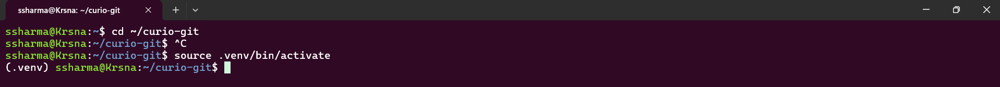
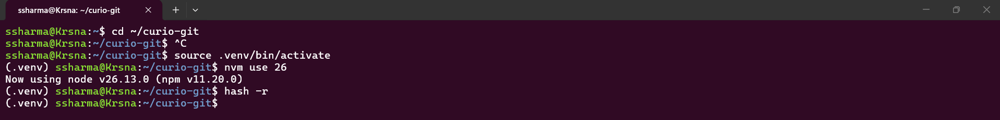
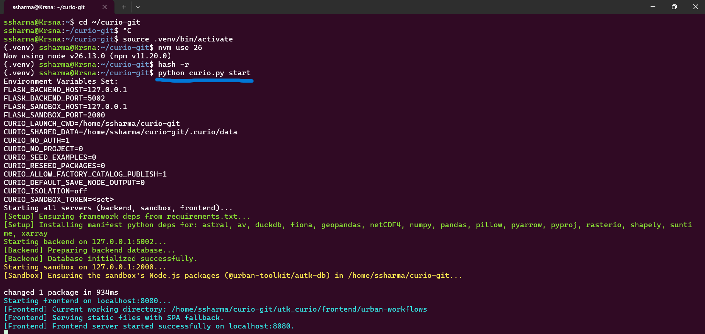

    Step 2: Go to localhost:8080 to open the Curio interface in your browser and select new dataflow to open a new dataflow
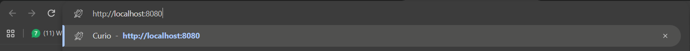
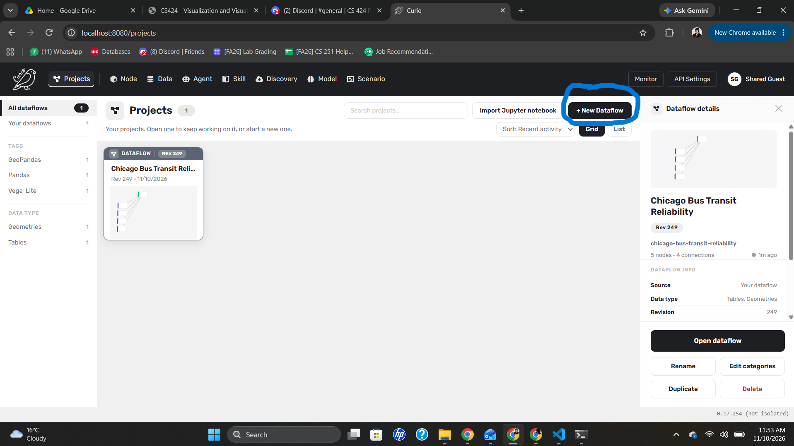
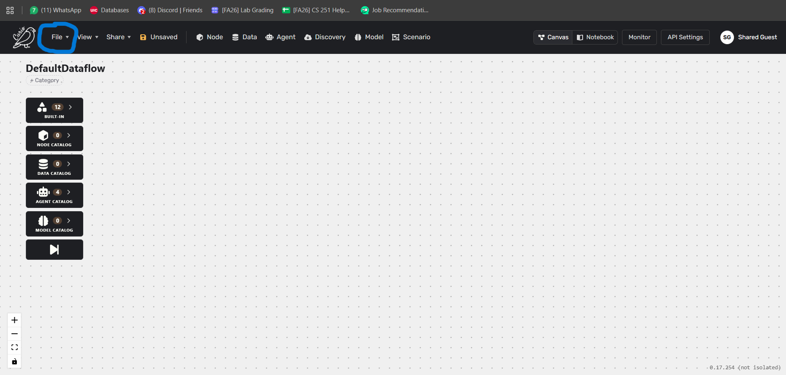

    Step 3: Go to file and load dataflow to open the dataflow file in the curio directory and run the dataflow using the sidebar
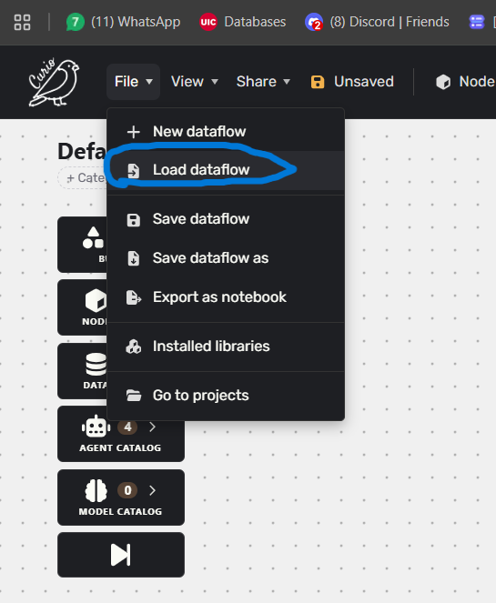
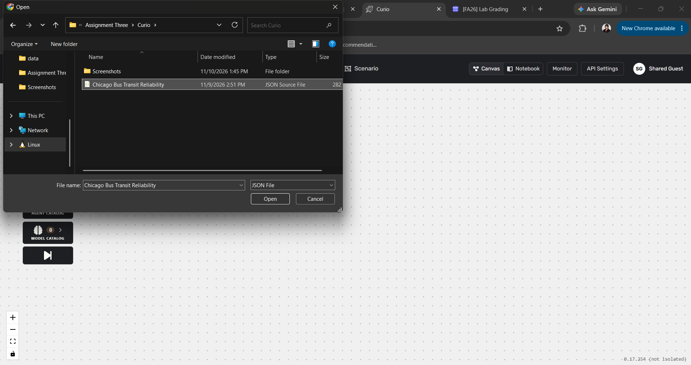
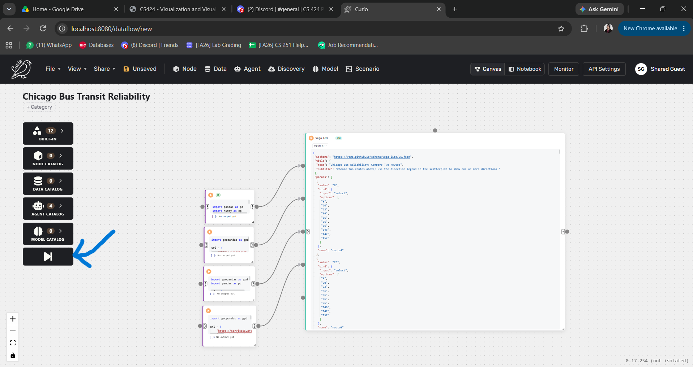
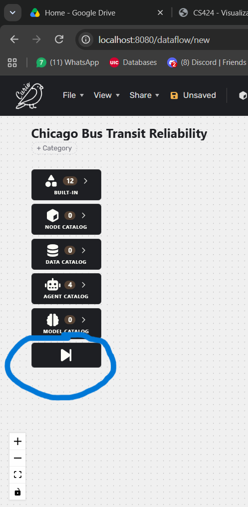

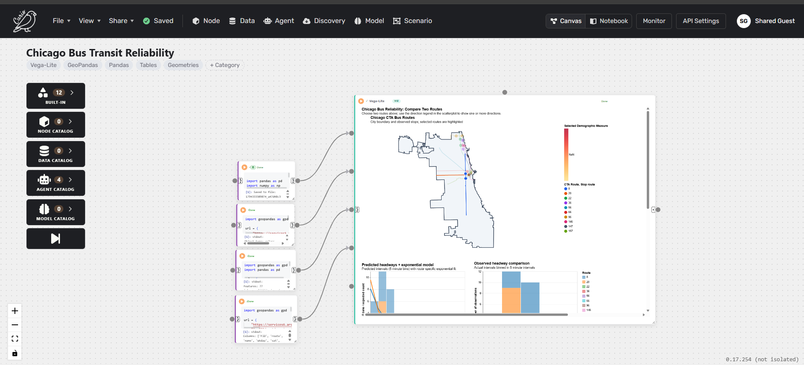

    Step 4: Scroll down and view the menu of the visualization node to select the routes, directions and demographic measure to explore the data
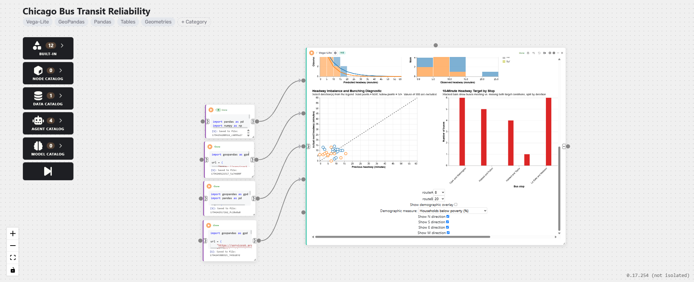

    Select a route from the Route A and Route B dropdowns to compare two routes.
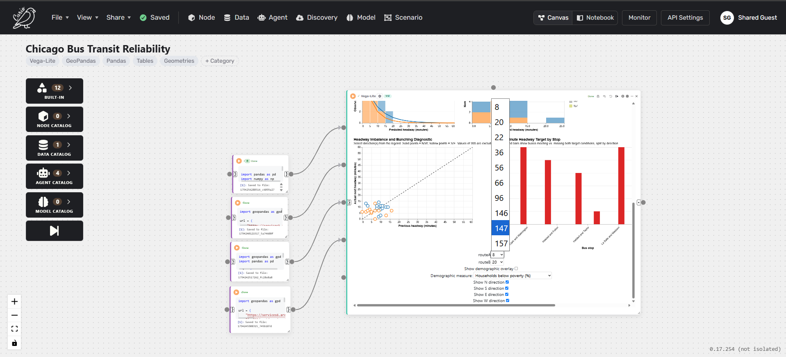
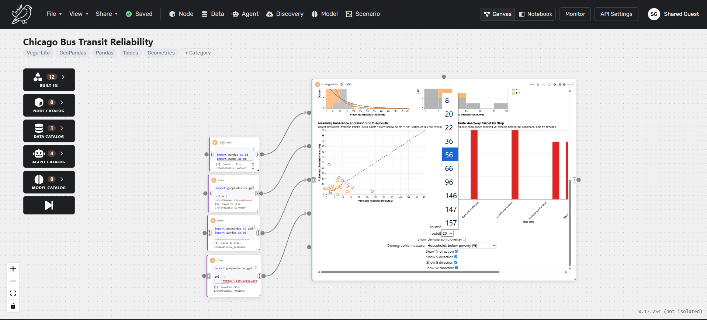

    Toggle the showDemographics checkbox to overlay the demographic choropleth on the map. You can view the demographic measure by selecting one from the dropdown menu. The map will update to show the selected measure for each community area. Hover over a community area to see its name and the value of the selected measure.
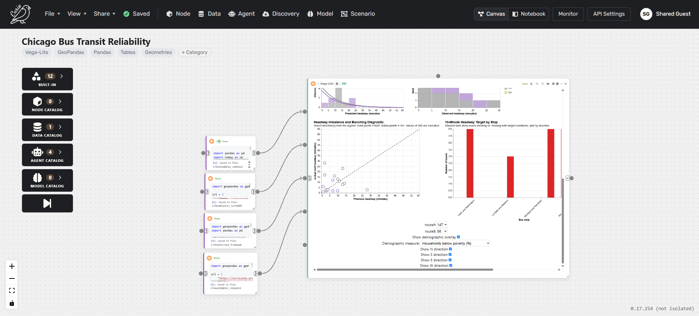
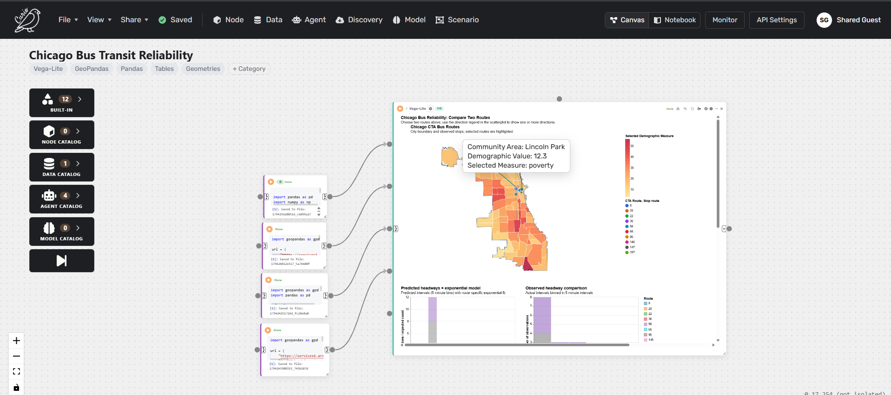
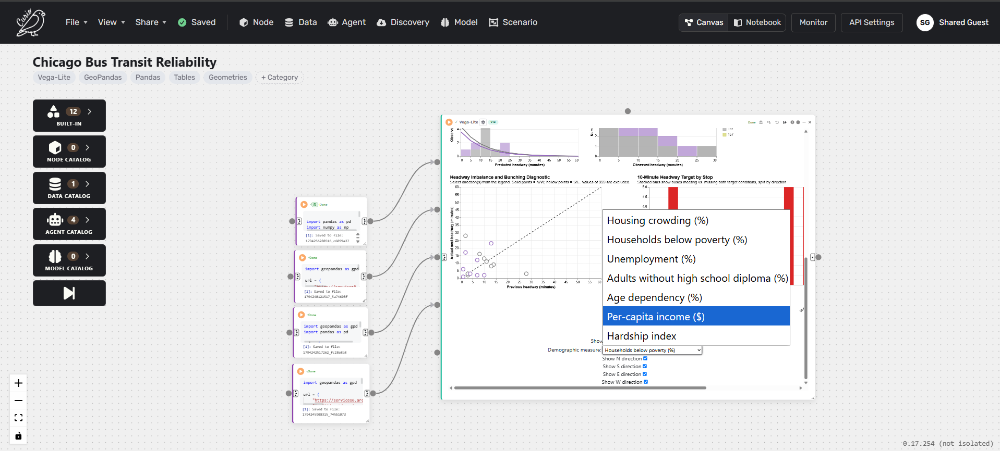
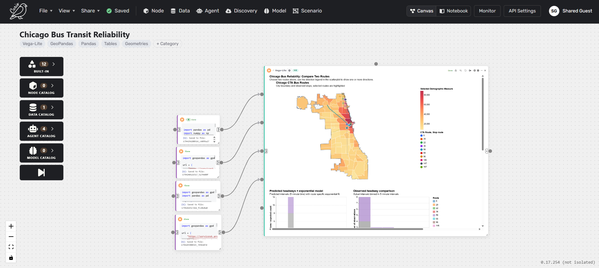

    Toggle the direction control to filter the observations by northbound, southbound, eastbound or westbound service. The scatter plot and target chart will update to show only the selected direction.
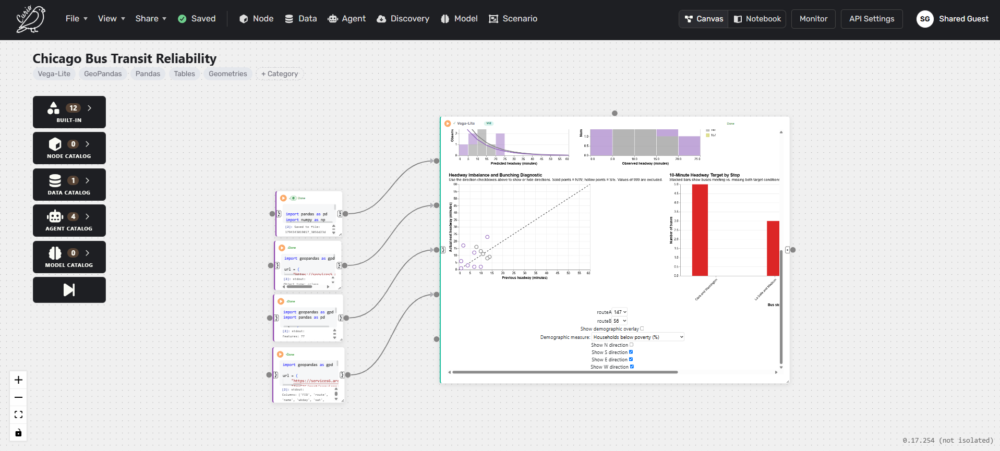
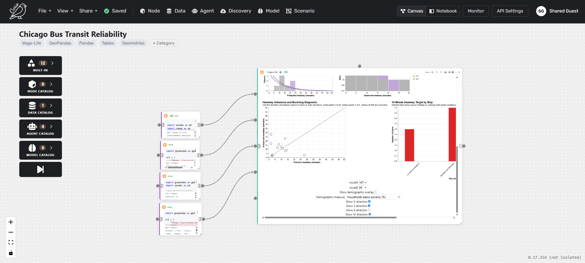

SECTION 7: REFERENCES

    Amar, R., Eagan, J., & Stasko, J. (2005). Low-level components of analytic activity in information visualization. IEEE InfoVis 2005, 111–117.
    Barr, D. J., Levy, R., Scheepers, C., & Tily, H. J. (2013). Random effects structure for confirmatory hypothesis testing: Keep it maximal. Journal of Memory and Language, 68(3), 255–278.
    Bates, D., Maechler, M., Bolker, B., & Walker, S. (2015). Fitting linear mixed-effects models using lme4. Journal of Statistical Software, 67(1), 1–48.
    Brehmer, M., & Munzner, T. (2013). A multi-level typology of abstract visualization tasks. IEEE TVCG, 19(12), 2376–2385.
    Charness, G., Gneezy, U., & Kuhn, M. A. (2012). Experimental methods: Between-subject and within-subject design. Journal of Economic Behavior & Organization, 81(1), 1–8.
    Cleveland, W. S., & McGill, R. (1984). Graphical perception: Theory, experimentation, and application to the development of graphical methods. Journal of the American Statistical Association, 79(387), 531–554.
    Cohen, J. (1988). Statistical power analysis for the behavioral sciences (2nd ed.). Lawrence Erlbaum.
    Dragicevic, P. (2016). Fair statistical communication in HCI. In Modern Statistical Methods for HCI (pp. 291–330). Springer.
    Greenwald, A. G. (1976). Within-subjects designs: To use or not to use? Psychological Bulletin, 83(2), 314–320.
    Hart, S. G., & Staveland, L. E. (1988). Development of NASA-TLX. In Human Mental Workload (pp. 139–183). North-Holland.
    Heer, J., & Bostock, M. (2010). Crowdsourcing graphical perception. ACM CHI 2010, 203–212.
    Heer, J., & Shneiderman, B. (2012). Interactive dynamics for visual analysis. Communications of the ACM, 55(4), 45–54.
    Holm, S. (1979). A simple sequentially rejective multiple test procedure. Scandinavian Journal of Statistics, 6(2), 65–70.
    Lakens, D. (2013). Calculating and reporting effect sizes to facilitate cumulative science. Frontiers in Psychology, 4, 863.
    Lam, H. (2008). A framework of interaction costs in information visualization. IEEE TVCG, 14(6), 1149–1156.
    Lam, H., Bertini, E., Isenberg, P., Plaisant, C., & Carpendale, S. (2012). Empirical studies in information visualization: Seven scenarios. IEEE TVCG, 18(9), 1520–1536.
    Lazar, J., Feng, J. H., & Hochheiser, H. (2017). Research methods in human-computer interaction (2nd ed.). Morgan Kaufmann.
    Little, R. J. A., & Rubin, D. B. (2019). Statistical analysis with missing data (3rd ed.). Wiley.
    MacKenzie, I. S. (2013). Human-computer interaction: An empirical research perspective. Morgan Kaufmann.
    Newell, G. F., & Potts, R. B. (1964). Maintaining a bus schedule. Proceedings of the 2nd Australian Road Research Board Conference, 2, 388–393.
    Nielsen, J. (1993). Usability engineering. Academic Press.
    Pangilinan, C., Wilson, N., & Moore, A. (2008). Bus supervision deployment strategies and use of real-time automatic vehicle location for improved bus service reliability. Transportation Research Record, 2063, 28–33.
    Poulton, E. C. (1982). Influential companions: Effects of one strategy on another in the within-subjects designs of cognitive psychology. Psychological Bulletin, 91(3), 673–690.
    Satyanarayan, A., Moritz, D., Wongsuphasawat, K., & Heer, J. (2017). Vega-Lite: A grammar of interactive graphics. IEEE TVCG, 23(1), 341–350.
    Sauro, J., & Lewis, J. R. (2010). Average task times in usability tests: What to report? ACM CHI 2010, 2347–2350.
    Shneiderman, B. (1996). The eyes have it: A task by data type taxonomy for information visualizations. IEEE Symposium on Visual Languages, 336–343.
    van Teijlingen, E., & Hundley, V. (2001). The importance of pilot studies. Social Research Update, 35.
    Ware, C. (2012). Information visualization: Perception for design (3rd ed.). Morgan Kaufmann.
    Wickelgren, W. A. (1977). Speed-accuracy tradeoff and information processing dynamics. Acta Psychologica, 41(1), 67–85.
    Wilcoxon, F. (1945). Individual comparisons by ranking methods. Biometrics Bulletin, 1(6), 80–83.
    Williams, E. J. (1949). Experimental designs balanced for the estimation of residual effects of treatments. Australian Journal of Scientific Research A, 2, 149–168.