Matthew Horowitz, Mahd Rai, Kaya (Shambhawi) Sharma

SECTION ONE: REFLECTION AND COMMENTS ON ITERATIONS SINCE REPORT ONE

    After completing assignment one, the group began to reflect on the scope and potential of the project. It was determined that, more data would be needed, and thus more collection should occur, and that the scope of research would have to be tightened. As noted in assignment one, having data samples that affectively represent bus reliability across the entire city, and during multiple time periods, would require a large team and endless hours to visit most (if not all) the neighborhoods in Chicago at all times of the day. Thus, the scope of the project changed.

    Reflection on Data:
    
        Given that data on all bus routes, at all different times of day and days of the week cannot be collected by just three team members, the scope of the data collected had to be refined, in tandem with the data questions--as noted in the next section--. Due to the size of Chicago, the group decided to eliminate most of the bus routes and stops from this project. Given that the most important feature of the CTA is routing passengers from neighborhoods into the downtown core--The Loop, Eastern West Loop/West Loop Gate, Southern River North, and Northern South Loop--, the research was rescaled to focus on North/South, East/West (including NW to SE) routes that feed directly into the Downtown Region.
        Thus, at this point, after consulting the CTA bus route map, the team decided to focus their data collection on the following routes:

            North/South-- 8 (Halsted), 157, 146 (Inner Lakeshore), 147 (Outer Lakeshore), 36 (Broadway), 22 (Clark)
            East/West-- 20 (Madison), 65 (Grand), 66 (Chicago), 56 (Milwaukee) [Note the Milwaukee bus is officially listed as a N-S bus, but travels on a NW-SE heading, thus it has been included in the E/W section]

    Reflection on Questions:

       Prior to this report, the group identified the following domain questions:

            Question 1 -- How accurately does Ventra predict the arrival of the next CTA bus?

            Question 2 -- Where and when do buses appear to bunch together?

            Question 3 -- Which locations and routes show larger differences between expected and observed service?

            Question 4 -- How does bus reliability vary across different times of day and days?

            Question 5 -- Which routes or locations have the greatest observed variation in bus spacing?

        Given the inability to visit all neighborhoods of Chicago, many of the original research questions had to either be eliminated or refined, while others can be retained. Questions 1 and 2 are general, and when applied to specific routes, can still be properly examined and thus will be retained.
    
    Further Reflections on Data Collection:

        As of now, the general method of collecting data--observing buses and comparing to Ventra app--will continue. However, upon discussing the progress the team was making, it became apparent that redunant variables--including the delta bus times (time elapsed from previous bus arrival) was redundant, as this attribute can be calculated later when creating the visualization. As a result, all attributes will be retained in the final data set, but many of these attributes will be calculated by the computer during the data cleaning process and stored, rather than being computed at the time of observation.

    Additional New Domain Questions:

    In addition to the previous domain questions, the following questions have been augmented to the research:

        Question 1 -- Given that poverty is concentrated on the South and West Sides of the City and wealth is concentrated in the north side, do north side residents get better bus service into the Loop than those living on the West Side? (Due to the formulation of CTA routes, adding South side comparisions is difficult as there are few direct bus lines from the Loop to the South side due to CTA Red and Green lines along with Metra District line trains).

        Question 2 -- Which of the routes examined sees buses most likely arrive as scheduled?

        Question 3 -- What is the probability a bus will arrive in a given time?

SECTION TWO: PREPARE THE DATA--PRIMARY DATA

    Before even attempting to prepare the data for analysis, visual inspection was conducted on the data collected so far. Visual inspection was done in two stages:

    1. Pre-python inspection. At this point, all data collected has been entered into an Excel Spreadsheet saved with .xlsx extentension. Each team member maintained their own data set, thus necessitating this first step. During this process:

        1. Each column (attribute) was examined to ensure consistency across the differing datasets. The sets will have to be merged. Missing attributes will cause problems.
        2. Visually check for missing data. Note: missing data will once again be inspected once all files are read into Python, but at this point, a quick visual inspection was done to see if there were any issues before any coding was attempted, and if issues arised, they could be flagged early.
        3. Attribute types. Prior to reading any data into Python, its important that all attributes are stored as the same type of data. Dates and times are particularly attributes that if stored differently can cause issues. Ensuring that days of the weeks are characters was another that needed to be similar. Before reading the data into Python, attributes will also be visual inspected for these types of issues.
    
    This pre-Python exploratory search was conducted in Excel first to minimize any conflicts that may arise once the data is read into a Python environment. Ordinarily, this step would be deemed inefficient if working with a very large data set. However, at this time, the data set contained a little more than 100 observations, and as such, conducting exploratory and cursory data checks first in Excel is manageable. It should also be noted that the group is still collecting data, and will continue to do so throughout the semester.

    Below is a comment on the visual pre-inspection:

        1. At the start of the visual pre-inspection, the data was organized into multiple files. These were:

            a. Data--DataPhase2Horowitz.xlsx
                     DataPhase2Sharma.xlsx
                     DataPhase2Rai.xlsx
        2. Next, each attribute was inspected. To do this a new excel file was created:
            a. The column names from each of the three excel files were pasted in one on top of another. This ensures that there are no missing attributes and that the attributes in the data set perfectly align. Note, in regards to column name changes, the group plans on reading these Excel files in without headers and then manually adding in column names using Pandas functions.
            b. Next, the data from each of the three above files was pasted in, one on top of the other in order to check that there is consistency in data types and to quickly see if any observations are missing data.

        In this step, the following should be noted:
            a. The columns were first pasted one on top of the other to be inspected. All columns matched, though some of the exact column names differed:
            -DataPhase2Horowitz used "Observation ID","Stop" and "StopID", while DataPhase2Rai and DataPhase2Sharma used "ID", "Stop-Street", and "Stop-CTA ID", but the attributes themselves were the same and all columns aligned. 
            b. After pasting the data, and excluding the Observation ID column--this was an value internal to each group member--, the data was inspected:
                -First, there appeared to be a quite a few missing values for "Observation Previous (in mins)" in DataPhase2Rai excel sheet. This is not a major issue since this is a calculated field, and as noted earlier in this report, a variable that can easily be calculated from the other data held in this excel file.
                -Second, in the DataPhase2Horowitz file, 20 stops carry the number 0 for bus stop id. This is because Loop Link stops do not display their stop number. This will be fixed in later steps when the group downloads the CTA GTFS data (see next section).
            c. Next, the data was read into a Python and placed into a Pandas dataframe. To simplify this process, theses steps were conducted using Google Colab.
                -A quick visual inspection was done again to make sure that all attributes are present and aligned and that there was no missing data. Each dataframes shape was also calculated and a list of column names returned to ensure data consistency.
                -Next, column names often had different spacing. White spaces were stripped from the end of column names to make it easier to work with and to ensure that data could be compared.
                -Next, the data types were inspected. To ensure that data types can easily be merged, all data types need to be the same. During this step, it should be noted that there were some discrepencies found. In particular, the variables corresponding to minutes were often found to be either float64 or int64. Whenever this discrepency arrived, the data was converted to int64 since the attributes where this discrepancy arised dealt with minutes, a discrete integer value. However, because some of the data in these attribute fields had values like NA, the group decided to replace any values of this kind with 999--since 999 minutes was not a real value this gibberish value was used in lieu of NA--.
                -Next, all columns were given the same name to ensure data consistency
                -Columns were then checked to make sure they had the same name and data type
                -Finally all three datasets were combined to form temp_df2, the combined dataset.
            d. Once the combined dataframe temp_df2 was created, each variable was inspected to make sure that there were no missing or incorrect attributes.
            e. Next, the stops with CTA-Stop ID 0 (the Loop Link stops), were correctly coded by adding in the codes stored in the CTA masterfile (see Secondary Sources folder in GitHub). 
            f. Finally, the geo coordinates for each stop latitude and logitude were appended. These were checked against Google Maps to ensure correctness.
            g. All N/A were handled, except in the comments section. This is an attribute that the group plans on using to help determine if certain Booleans, like reliability, should be created, and if so, how they should be handled. As of now, having missing attributes in this field is not an issue.
            h. The data was written out to a CSV file so that it can be used called Cleaned-Data-10-18-26.csv. Note, at this stage all columns were included, though some of these attributes are redunant and can be calculated on the fly.
            The data was comprised of the following attributes:
                -ID (this is just for internal checks)
                -Date
                -Day of Week
                -Route
                -Stop-Street
                -Stop-CTA ID
                -Direction
                -Ventra Time (calculated when previous bus arrives)
                -Real Time
                -Observation Previous (in mins)
                -Observation Next (in mins), based on Ventra App
                -Actual Next (in mins)
                -Comments
                -Stop_lat
                -Stop_lon

            The final dataset was comprised of 203 observations with these 15 attributes.

SECTION THREE: EXPLORE THE DATA AND DISCUSS SECONDARY DATA

        After preparing the primary data, cleaning and inspecting data quality, the group then turned to exploring both the data collected and any secondary data needed to answer the domain questions. Census and City of Chicago produced data was inspected to help add demographic data allowing the group to create visualizations that depict differences in socio-economics between the West and North sides of the city. In this section, the group analyzed some interesting patterns found in the primary data we collected, plus interesting features in the secondary data downloaded from the City of Chicago portal.

        Primary Data:

        After cleaning up the data, and producing a finalized dataset on October 18, 2026--note data collection will continue throughout this project, as of now this is the data set the group will use for submission two to ensure consistency--, exploratory research on the data was conducted. Below are the steps taken, and subsequently a discussion on findings.

                1. Basic distributions were generated. This was done to ensure that the data is fairly balanced. While the group will collect more data throughout this research, ensuring the data is fairly balanced will allow the group to check for interesting statistical anomalies, like bus bunching, or frequent delays. Such statistical measures will require calculating standard deviations or t-tests. This can only be done if data is fairly balanced. This step was conducted in two ways. First, basic counts by lines were generated, and then second, the frequencies by bus line were plotted into a bar chart to allow the group to see the distribution in a more visual way.
                
                Below is the output for the bar chart:

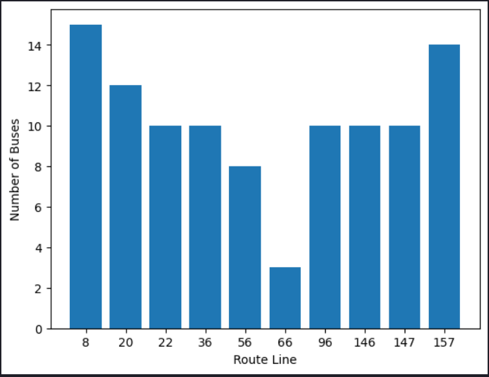

                Here we can see that with the exception of Route 66 Bus (more of which will be collected in the subsequent week), the data looks fairly balanced, with most routes having anywhere from 8-12 observations. The inbalance shown with Route 66 is not surprising. This route, along with Route 12 and 65, are amongst the last routes that the group expects to collect more data for. In particular, given construction on the Chicago/Halsted viaduct, re-routes have meant that collecting data for this line will require extra time, and the need to   
                As such, provided Route 66 is excluded from statistical analysis, all other lines can be examined for insights.

                2. The next area of interest is looking at bus frequencies within lines. Here, the group, turned to the attribute 'Previous Observation (in mins), which calculates the time between buses. The idea here is to see if any buses aren't on average, count, or median, not meeting the 10 minute headway target (all routes examined here are part of the CTA 10 minute target, as discussed in Report One). These were printed out by bus route.

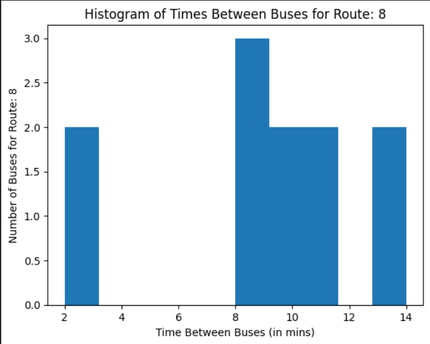
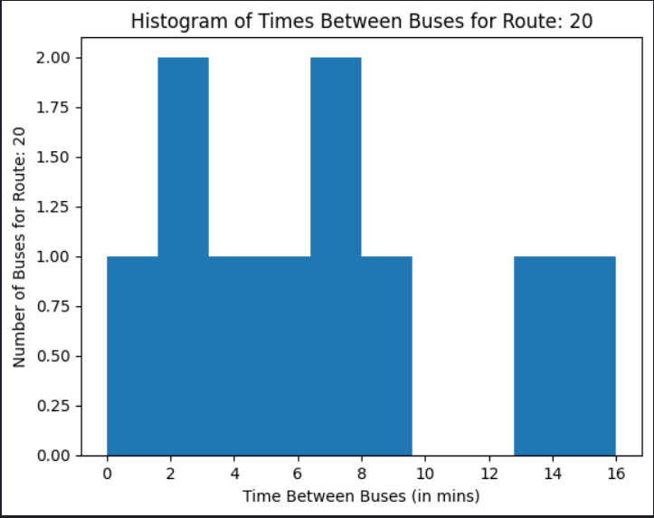
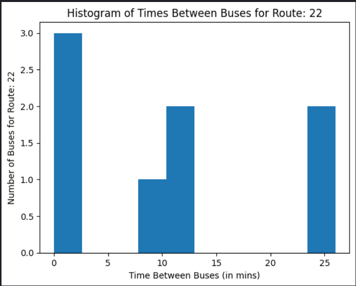
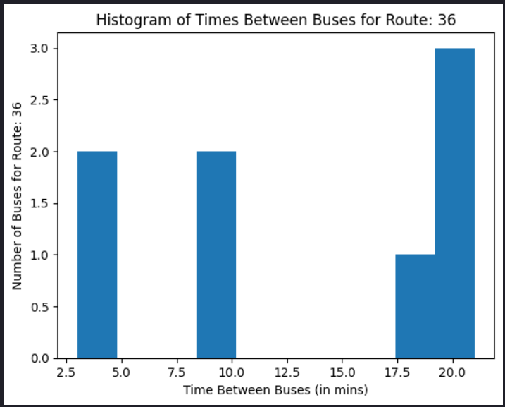
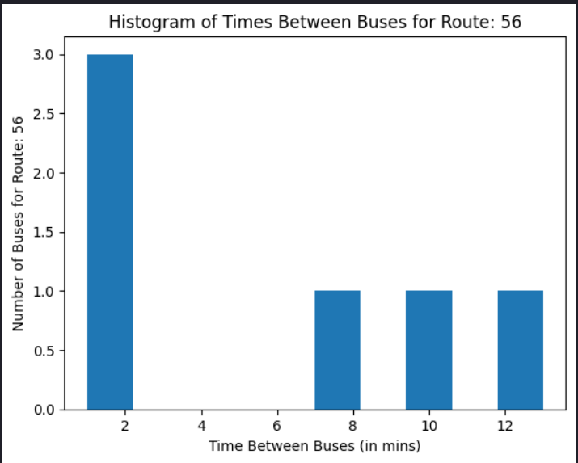
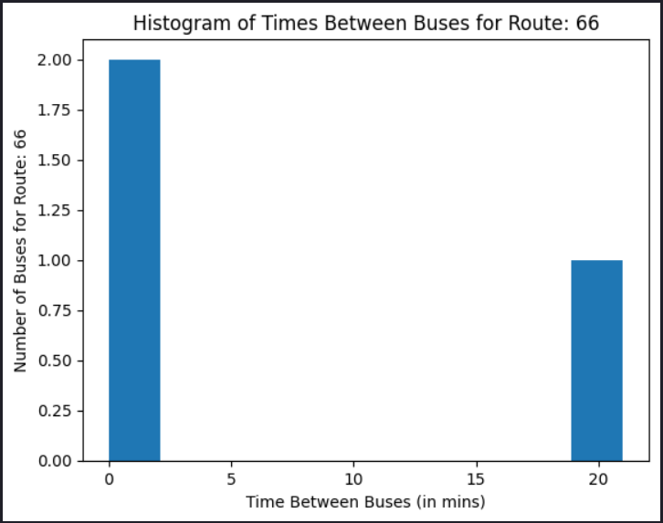
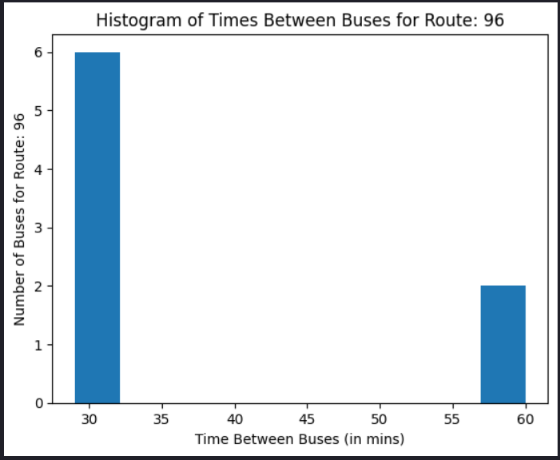
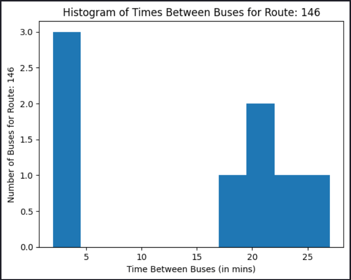
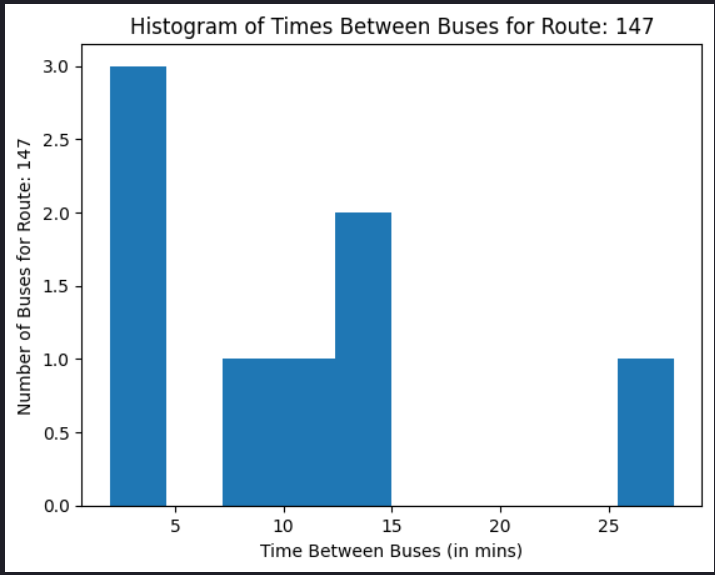
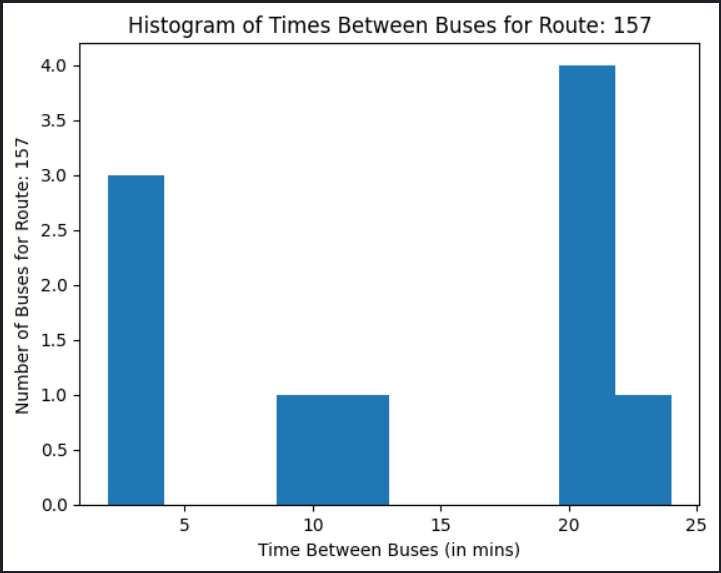

                Here we can see that almost half of all  bus arrivals for each of the lines observed did not meet CTA headways. In particular:
                        -Four out of eight of route 36's arrivals were outside of CTA guidelines
                        -Five of the eight observations for route 147 exceeded its headways
                        -Six of the 10 for Route 157 also exceeded headways

                3. The mean, standard deviation, and coefficient of variation for wait times per bus line was printed out. The idea here was to see how long the average wait time was (did it conform to CTA headways of 10 minutes), as well as how representative the mean wait time was, by calculating the coefficient of variation for all bus lines. In addition to verify the spread found by calculating the coefficient of variation, box and whisker plots for each each lines wait time was produced.

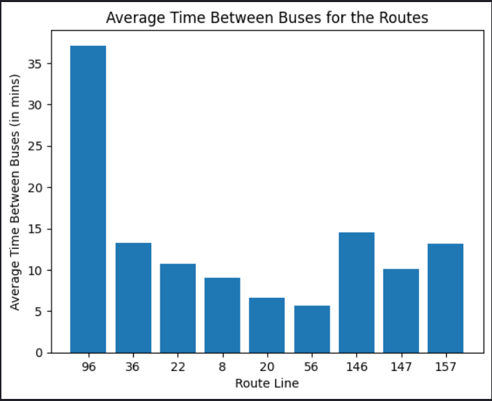
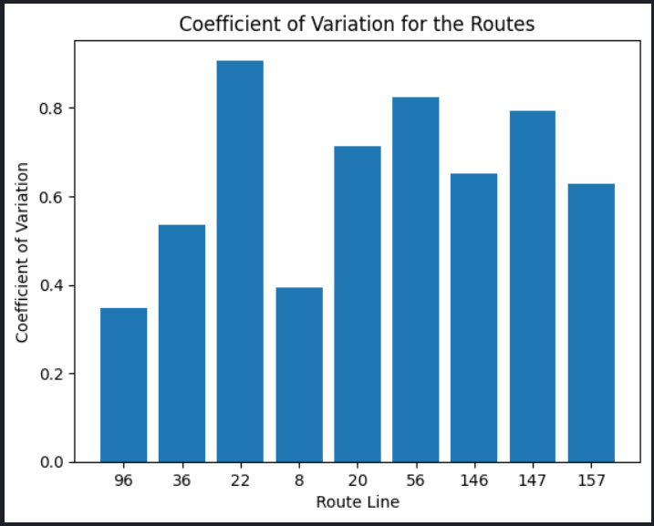
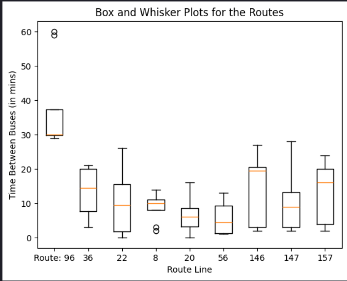

                Here again we see that some routes experienced significant deviations from CTA guidelines:

                        -In terms of average times between buses:
                                -Route 36 was 13.25 minutes
                                -Route 96 was 12.92 minutes
                                -Route 147 was 12.92 minutes
                                -Route 157 was 13.2 minutes
                        -Standard deviations and coefficients of variations in time were fairly uniform for all lines, though there was some variation ranging from .4-.8, with most coefficients of variation around the .5-.6 ratio.
                        -Looking at the box and whisker plots, only Bus 96 showed serious levels of deviation (with two outliers), though Route 8 did have two outliers as well. Almost all routes showed similar interquartile range dispersions (number of minutes between the 25th and 75 percentile), though median and IQR times varied significantly across routes, with Route 56 and Route 20 having the shortest median wait times of around 7-8 minutes and Route 96 having the longest at almost half and hour.

                

                4. The group intends to allow users to compute probabilities of bus arriving by line, while using the visualization. Given that bus wait times tend to follow an exponential distribution, each bus lines headways were tested to see if they fit an exponential distribution using a Lilliefors Kolmogorov-Smirnov test. If a distributions p-value exceeded .05 test statistic then it can be said that a bus line follows an exponential distribution, thus estimating its density distribution can be done parametrically--estimating lambda--. See next section for a discussion.

                5. Actual headways were tested. The delta time difference between the time a bus arrived and when Ventra predicted the arrival was calculated, with the Ventra time captured when the previous bus left or when the observer first arrived at the stop to begin recording data. These delta values were then averaged by bus line, and the calculations were then plotted, where it was noted that negative number correspond to early arrivals, which according to the CTA should be no more than one minute early, five minutes late.

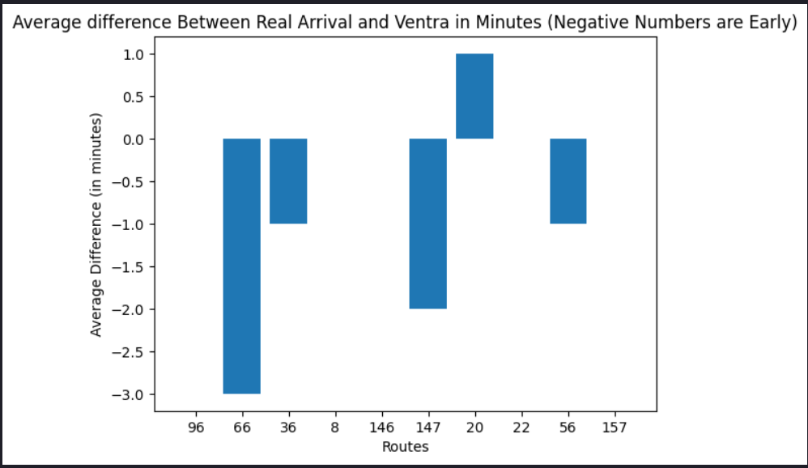
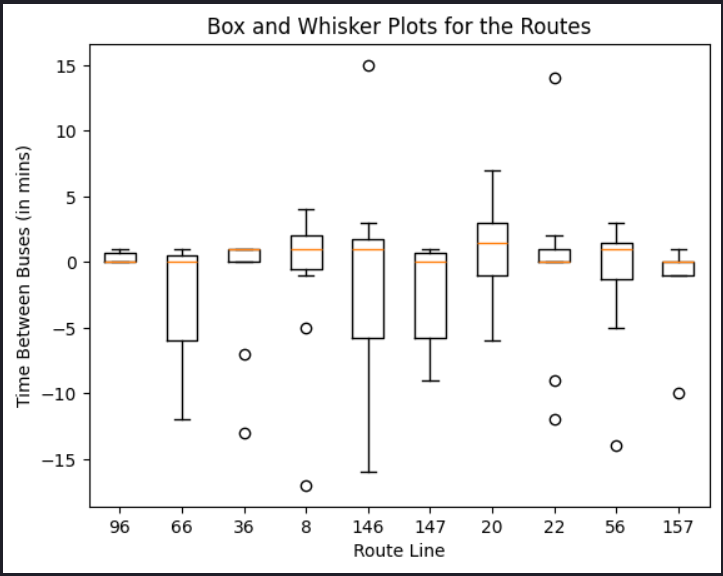

                Here, the bar chart for average by bus line for the delta time between real arrival and Ventra time and the box and whisker plots for each individual delta time aggregated solely by bus line show that:
                        -On average many buses arrive earlier than predicted with the 66 bus arriving early by 3 minutes and the 147 by 2 minutes.
                        -On average, only 20 bus appears to arrive later than predicted.
                        -The median values for these lines show that unlike the average, the median bus line's arrivals come in around the time expected, per the Ventra real time. Though bus lines 146, 20, and 66 had greater dispersion of times than the other lines.
                        -Finally, it is important to note that as a result of conducting these visualizations:
                                -The median bus per line, does arrived as predicted by Ventra within the CTA guidelines of no earlier than 1 minute no later than 5.

                6. Aggregation into North/South, East/West routes. Since this visualization aims to help explore the differences in reliability between North/South vs East/West lines, especially the idea tha the wealthy north side of the city gets better service, average headways per route and average delta times between real arrival time and Ventra predicted times per route were then aggregated into a N/S or E/W group, based on the bus line. To cross check the differences in average headways by geographic heading, similar to line side by side comparison, box and whisker plots were conducted on all wait times that corresponding with north-south lines and then compared to east-west lines.

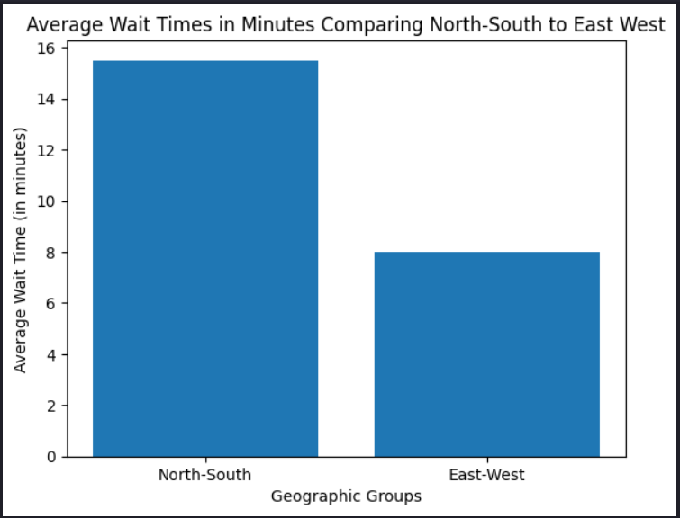
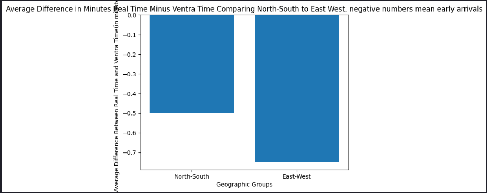
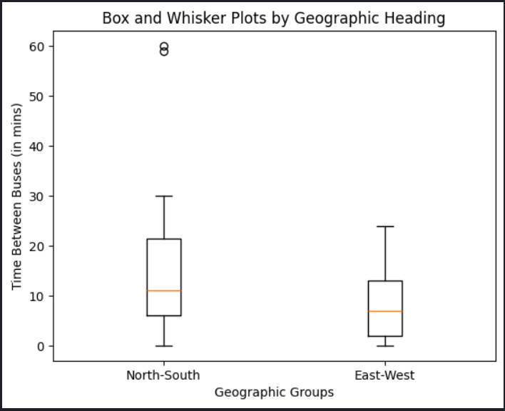
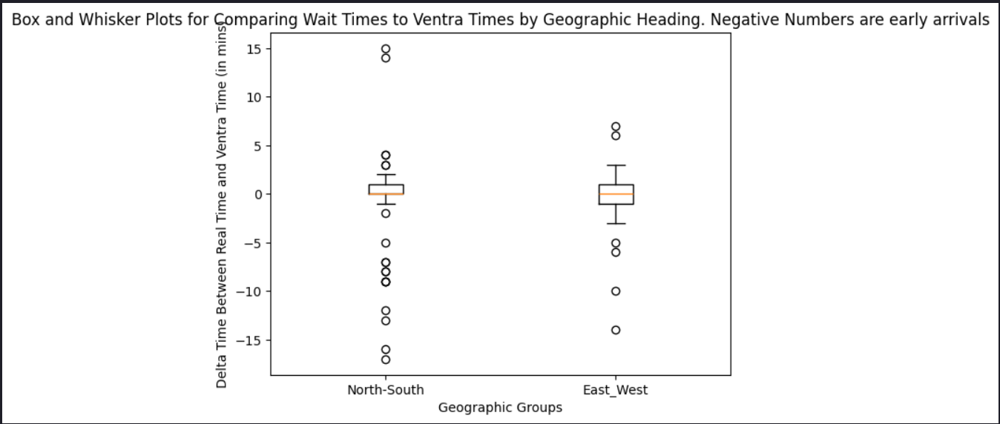

                Here, box and whisker plots show that the median bus does arrive as predicted by Ventra but North South buses have greater variance and more outliers than East West Buses.

        DISCUSSION ABOUT PRIMARY DATA:

        This section was conducted in two ways. First, data was explored in an aggregated manner, grouped by line or geographic orientation. Means and standard deviations were first to see if buses had wait times that exceeded CTA requirements. These were conducted first because averages tend to be the most sensitive to data variations, and as such gave a good baseline for exploring the data. Subsequently, the data was explored in a more disaggregated manner. While data points were still grouped by either line or geographic orientation, the data points were not aggregated during this stage, thus allowing means, interquartile ranges and outliers to be detected.

        A few interesting patterns were detected during the exploratory phase of inspecting the primary data. Prior to doing this exploratory data, it was assumed that wealthier districts, namely those on the west side would be better served by CTA buses into the downtown. In terms of looking at the aggregated data:
                -Average times both by bus line, or by N-S vs E-W heading, showed longer wait times. In particular, route 96 had wait times that exceed half an hour on average, and lines 146 and 147 which form the backbone of the lakefronts N-S routes had average wait times of around 15 and 12 minutes respectively. Compare this to Routes 20 and 56, two of the most important E-W bus lines, each of which had average wait times of around 6-8 minutes. And since all lines appeared to have similar coefficients of variation (.7-.8), with only 8 and 96 having slight differences (.4-.5), it can be said that the mean fairly accurately represents the true wait times found by line.
                -Average deviation between real and ventra times were also calculated and depicted using a bar chart. 
                -In terms of visualizing these averages and coefficients of deviation, bar charts were used. These work best when trying to visualize a single data point (like mean or coefficients of variance), and then allow for these single points to be compared across all lines of geographic orientation.

        But to confirm these findings, the data was then explored at a disagregated level, to ensure that the mean wait times found above did in fact show meaningful variation.
                -Histograms were run to detect distributions of wait times based on CTA bus line. They key was to see if the data followed a normal distribution or if it followed, as expected an exponential distribution. Most of these histograms showed some element of an exponential distribution, with histograms being right skewed, and the majority of arrivals happening earlier than later. Line 147 and 66 showed the greatest levels of exponential patterns, and for this reason, Lillefors K-S tests were run (see the above section). Such tests confirmed that almost all lines other than 96 and 8 bus did appear to follow an exponential distribution. This will be important as any future interactions may require computing probabilities of buses arriving at a given time, and thus knowing the data follows an exponential distribution will ensure that a parametric approach to estimating the distribution can be conducting, and in turn only lambda will be needed to be computed.

                -Box and whisker plots were run to see if median values, interquartile ranges, and spread of data--along with outliers--really showed meaningful variation between lines and between georgraphic orientations. Some interesting finds came from this that did not appear when only the aggregated data was explored (see above). In particular, Route 96 showed a huge variation in distribution of arrival times, as did Route 146. Both lines had significant outliers, that were not expected upon initial inspection of the data. 

                -Box and whisker plots were used for this section because they efficiently show medians, interquartile ranges (the boundaries of the box), 1.5x the IQR and any outliers, while such a visualization allows for such box plots to be plotted agains one another, allowing for efficient line by line or geographic heading comparisons. 

        The findings confirmed some of the group's previously held beliefs while it also conflicted with others. In terms of confirmation, the group expected most bus lines to follow an exponential distribution, wait times almost always tend to follow this distribution. On the other hand, previous beliefs led the group to believe that wait times, headways, and early arrivals would all be lower for buses on the northside, where Chicago's wealth is concentrated, that on the West side, which while gentrifying is historically been seen as one of the poorest sides of the city--see Secondary Data--. But the exploratory analysis and visualizations showed the opposite. Not only did aggregate analysis show that bus headways on the whole were longer for north side buses, bus disaggregated analysis showed the north side buses also had greater spread in both their headways and deviation from ventra time, which coefficient of variance analysis did not always pick up, showing that exploring the data in both an aggregated and disaggrated level of analysis was essential.

        Finally, it is important to note that much of this analysis is built off of a small data set--102 observations collected by October 18th--. Data collection is ongoing, but the data that was used in this analysis was limited. With more data, further exploratory analysis and visualizations can be conducted. Perhaps, with more observations, different conclusions will be drawn. Perhaps northside service is more reliablity, perhaps all lines do follow an exponential distribution for wait times, and perhaps there will be less deviation, especially for line 96 whose outliers may have been the result of limited data collected at a specific time frame. This is an area the group will revisit with data that has been newly collected since the exploratory analysis was carried out.

        DISCUSSION ABOUT SECONDARY DATA:

        Given that census informations plays such a large roll in exploring north side differences compared to west side differences, the team turned towards the City of Chicago data portal to look for relevant census data sets.

        For this project, the group will use the most recent ACS collected data provided by the City of Chicago--and is the file currently in use by city authorities--.
        This dataset: "Census Data - Selected socioeconomic indicators in Chicago, 2008 – 2012 (Updated August 31, 2026)" is comprised of:
        -77 records (one for each Community Area in Chicago)
        -9 Attributes:
                Community Area Number.................Integer
                Community Area Name...................Text
                Percent of Housing Crowded............Float
                Percent of Households Below Poverty...Float
                Percent 16+ Unemployed................Float
                Percent Aged 25+ No HS Diploma........Float
                Percent Under 18 or Over 65...........Float
                Per Capita Income.....................Integer
                Hardship Index........................Integer
        
        A brief examination of the data was conducted. As this is the data used by the City for official policy formulation, no transformations were done on the data, so as to ensure that any findings that should arise from integrating this data into the group's collected bus data would follow the same guiding principles that guide any other public policy research conducted by the city.

        The first step in analyzing this data was to find the community areas with the lowest and highest hardship index. Since the domain questions for this project all center around the very idea that neighborhood wealth and vitality--which tend to be found on the north side--and the converse tend to be found on the south and west sides, cross checking this using the census data was conducted. This was cross checked by sorting on the hardship index--an index created by taking a composite of all the other numeric attributes in the dataset, normalized and scaled to 1-100 and then aggregated.
                In Python, the CSV file was read in and the hardship index was examined. The top 10 community areas for hardship were all on the south or west sides. The community areas with the lowest hardship were found either in the greater downtown area or on the north side, confirming the suppositions this report was based on when formulating the domain questions.

        Next, the group looked at the hardship index attribute. Since the domain questions for this project all center around the very idea that neighborhood wealth and vitality--which tend to be found on the north side--and the opposite found on south and west sides-- which of the six attributes that are used to create the hardship index are most important. These attributes will be included in the final visualization.

        For this section, a covariance matrix on those six attributes and the target hardship index variable was produced. All of the input variables, with the exception of "Percent of Housing Crowded" and "Percent Under 18 or Over 65" produced a correlation greater than .79 (either positive or negative), with "Per Capital Income" producing the greatest correlation of -.85. Below is the output:

        
                Percent of Housing Crowded............ .65
                Percent of Households Below Poverty... .8
                Percent 16+ Unemployed................ .79
                Percent Aged 25+ No HS Diploma........ .8
                Percent Under 18 or Over 65........... .69
                Per Capita Income.................... -.85

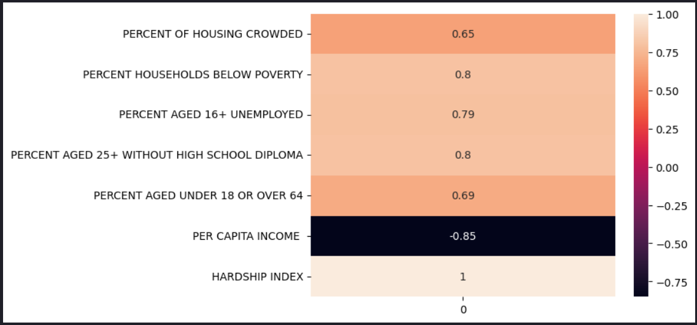

        As such, the group will use the attributes one by one in the order they are correlated with the target Hardship variable in the visualization process, and will determine which of these attributes makes the strongest visualization. Afterwards, combinations of these attributes will also be used as the group continues to iterate through design encodings.

SECTION FOUR: IMPLEMENT VISUALIZATION ALTERNATIVES

        Building on from the previous visualizations in Assignment One, the group decided to implement three first visualizations to see what works and what does not work. The group decided to first implement Figures 1, 10, and 11 from Assignment One, with some modifications, as we felt these were the strongest visualizations and wanted to explore them in greater detail. This section displays each of these visualizations, coded up in using JSON based Vega Lite, and walks through the components.

    Figure 1:

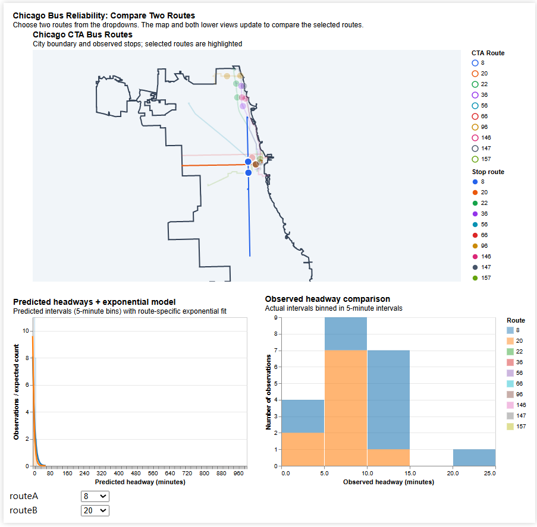

        This visualization supports the following questions and tasks:
            	1. Compare actual and predicted values
	        2. Compare variation in headways.
	        3. Compare service across differnt routes and different geographic locations.

        It supports these questions by utilizing a the following set of attributes:
                1. Route
                2. Stop location (latitude and longitude)
                3. Stop ID and CTA stop ID
                4. Stop name or intersection
                5. Direction
                6. Observation number
                7. Date
                8. Actual time
                9. Ventra time
                10. Observation Previous
                11. Actual Next
                12. Observation Next
                13. Latitude
                14. Longitude

        To create this visualization, we encoded the following marks and visual channels, mapping each observation the following marks and encoding their values with the following channels:
                1. City boundary: Filled geographic shape with a light background and dark outline.
                2. Bus routes: Geographic route lines displayed using geoshape marks.
                3. Route color: Different colors distinguish the ten CTA routes.
                4. Route opacity: Selected routes are highlighted, while other routes are faded.
                5. Bus stops: Filled circular points identify observed stops on the map.
                6. Map position: Longitude and latitude determine the geographic positions of routes and stops.
                7. Map tooltips: Hovering over routes or stops reveals details such as route number, stop ID, intersection, and direction.
                8. Predicted headway distribution: Bars show the frequency of predicted headways grouped into five-minute bins.
                9. Exponential model: Colored lines represent the expected distribution of predicted headways for each route.
                10. Observed headway distribution: Bars display observed headways grouped into five-minute bins.
                11. Horizontal position: Headway duration in minutes.
                12. Vertical position: Number of observations or expected count, depending on the chart layer.
                13. Color: Route identity distinguishes observations and model curves.
                14. Route selection: Two dropdown menus allow users to select routes for comparison across the map and quantitative views.

        Why you tried this approach.
                The visualization was designed to combine geographic context with quantitative comparisons of bus reliability. The map allows users to understand where the selected routes operate and where the observed stops are located, while the two lower charts provide a more detailed comparison of predicted and observed headway distributions. The exponential model adds a reference for examining the distribution of predicted intervals. By linking the views through route-selection dropdowns, the design aims to let users move between the geographic distribution of service and the statistical patterns that may indicate bunching or long gaps.

        What worked and what did not.
                This visualization had many components that worked. In particular:
                - The map provides geographic context for the selected routes and their observed stops. This was done to convey geographic and spatial understanding allowing for North and West sides to be compared. The group felt that including tis enabled easy comparison of the different Chicago regions.
                - Using distinct colors makes it easier to distinguish routes and compare their spatial coverage. Such channels were very effective and will be used throughout.
                - The route dropdowns provide a straightforward way to focus on two routes rather than examining every route simultaneously.
                - The two lower charts allow users to compare predicted and observed headway distributions.
                - The exponential model offers an additional reference for interpreting predicted headway patterns.
                - Tooltips provide additional stop and route information without requiring permanent labels on the map.
                However, there were aspects of this visualization that did not work:
                - Showing many routes simultaneously can create visual clutter, particularly where route lines overlap or stops are close together.
                - Fading unselected routes reduces clutter but does not remove the underlying visual complexity.
                - The map shows where routes and stops are located, but it does not directly communicate the magnitude of a service gap.
                - The headway charts summarize distributions, so they do not preserve the complete chronological sequence of bus arrivals or clearly identify exactly when a particular bunching event occurred.
                - The exponential model may be difficult to interpret without a clear explanation of how expected counts relate to observed headway frequencies.
                - The visualization relies on multiple external geographic data sources and embedded observations, which can introduce technical and data-consistency issues.
                - The dataset contains sentinel values such as 999 for some headways. These values need to be handled carefully so that missing or unavailable intervals are not mistaken for real service gaps.
                - The map and lower charts provide complementary information, but the relationship between an individual stop on the map and a specific observation in the charts is not directly explored through a stop-level selection interaction.
        All of these are issues the group will continue to think about and decide how to mitigate.

        At this point we decided to modify and retain the visualization as a combined geographic and quantitative view of bus reliability. The map is useful for identifying route coverage and locating observed stops, while the lower charts help compare predicted and observed headway patterns. Keeping these views together provides a broader understanding of service reliability than either the map or the charts could provide independently. We would retain the two-route dropdowns and route highlighting because they help users focus on a manageable subset of the data. However, we would improve the chart labels and explanation of the exponential model, ensure that sentinel values are excluded or clearly identified, and consider adding a more detailed timeline view to show the sequence of individual bus arrivals. This would make it easier to connect statistical patterns to specific instances of bunching and long service gaps. We would also retain the geographic map as a complementary view rather than relying on it alone to communicate reliability.

    Figure 10:

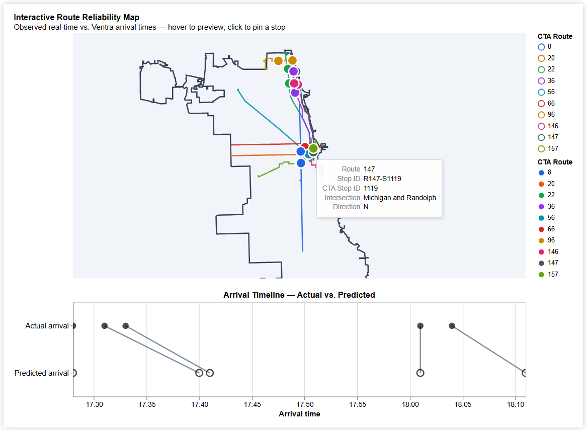

        What question or task it supports.
            	1. Compare observed bus reliability across different geographic locations.
	            2. Identify locations with unusual bunching or long service gaps.
	            3. Compare predicted and actual bus arrivals at selected locations.
	            4. Locate routes or stops where service patterns warrant further investigation.
        Which data attributes it uses.
                1. Route
                2. Stop location and CTA stop ID
                3. Direction
                4. Date and time
                5. Real Time
                6. Ventra Time
                7. Observation Previous
                8. Observation Next
                9. Actual Next
        The main marks and visual channels.
                1. Map: route lines and stop points
                2. Map position: geographic location
                3. Timeline points: individual bus arrivals
                4. Horizontal position: arrival time
                5. Distance between points: actual headway
                6. Secondary predicted marks: Ventra arrival predictions
                7. Distance between predicted and actual marks: prediction error
                8. Selection/highlighting: selected route or stop
        Why you tried this approach.
                The map-based visualization was chosen to provide geographic context for bus reliability across Chicago. By displaying bus routes spatially, the visualization allows users to identify where delays and irregular headways occur and whether certain areas experience more reliability issues than others. This approach supports targeted analysis by connecting bus performance data to real-world locations.
        What worked and what did not.
                What worked:
                - The map provided a familiar geographic reference, making it easier to understand where bus routes operate across the city.
                - Displaying multiple routes together helped users compare their geographic coverage and identify areas of potential interest.
                - The spatial approach offered a useful way to explore bus reliability in relation to specific routes and locations.
                What did not work:
                - Displaying multiple routes and observations on the same map could make it difficult to distinguish individual patterns, especially when routes overlapped.
                - The map did not communicate the magnitude of headway differences as directly as a quantitative chart.
                - Technical issues with rendering the map and displaying the route data made it difficult to achieve the intended visualization reliably.
                - Design decisions regarding keeping the map static versus allowing for zooming and panning affected the usability of the visualization.
                - Design decisions regarding keeping the rectangular view at the bottom confined to a strict one hour window limited the ability to see longer-term patterns in bus reliability.
        Whether you decided to keep, modify, combine, or abandon it.
                We decided to modify and retain the map-based visualization as a complementary view of bus reliability. It is useful for understanding the geographic distribution of routes and identifying where further investigation may be needed. However, rather than relying on the map alone, we would combine it with a quantitative visualization that makes headway deviations easier to compare. This allows the map to provide spatial context while another view communicates the underlying data more precisely. We abandoned the zooming and panning functionality in favor of a static map to reduce complexity and improve usability, while still allowing users to explore the data through other linked visualizations. We also abandoned the strict one-hour window in favor of a more flexible time range to allow users to explore longer-term patterns in bus reliability.

    Figure 11:

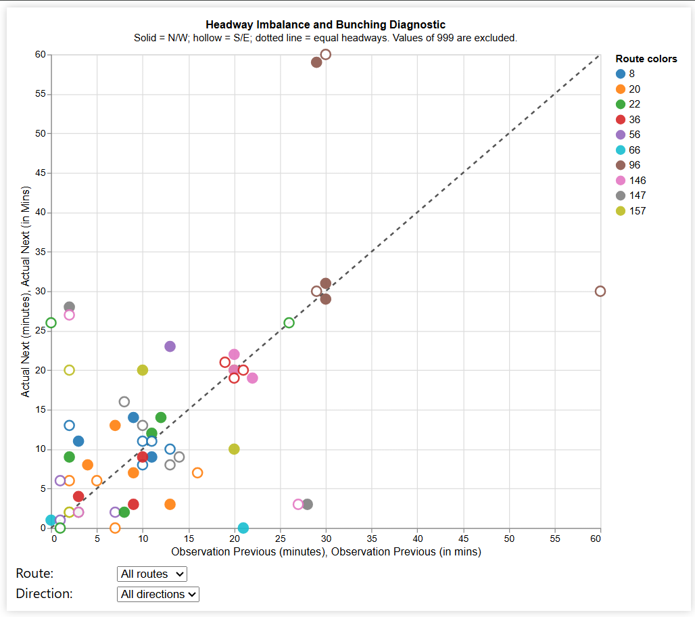
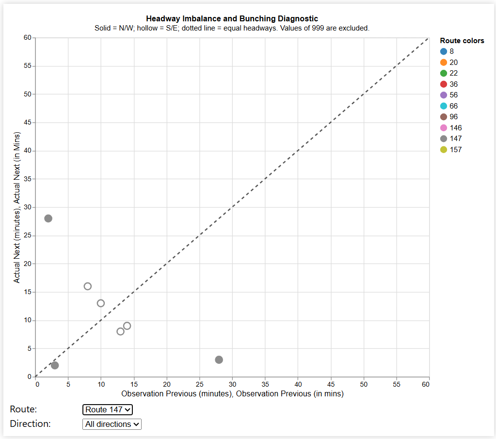

        What question or task it supports.
                1. Identify buses associated with unusually uneven service spacing.
                2. Compare headway patterns across routes.
                3. Determine whether short headways are followed by long service gaps.
                4. Determine whether long gaps are followed by closely spaced buses.
                5. Identify routes with the strongest evidence of bunching.
        Which data attributes it uses.
                1. Observation Previous
                2. Actual Next
                3. Route
                4. Stop
                5. Direction
                6. Date
        The main marks and visual channels.
                1. Point: individual bus observation
                2. X-position: actual headway from previous bus
                3. Y-position: actual headway to next bus
                4. Diagonal reference line (y = x): balanced service
                5. Distance from diagonal: degree of headway imbalance
                6. Position above/below diagonal: direction of the imbalance
                7. Grouping/selection: route
        Why you tried this approach.
                The scatterplot was chosen to compare the previous bus headway with the actual time until the next bus arrived. Each point represents an observation, with the previous headway on the x-axis and the actual next headway on the y-axis. A reference line representing \(y=x\) provides a baseline for comparison: points near the line indicate similar consecutive headways, while points above or below it indicate differences between the two intervals. Color distinguishes bus routes, and filled versus hollow points distinguish travel directions.
                This approach provides a direct way to examine headway balance, compare observations across routes, and identify unusually large differences.
        What worked and what did not.
                What worked:
                - The scatterplot made it easier to compare previous and actual next headways quantitatively.
                - The \(y=x\) reference line provided an intuitive baseline for identifying observations where consecutive headways differed.
                - Using different colors for routes and different point fills for directions helped distinguish observations within the same chart.
                - Excluding invalid observations with a headway value of 999 helped prevent those values from distorting the displayed patterns.
                - The chart supported comparisons across routes without requiring users to interpret the geographic layout of the city.
                What did not work:
                - When many observations were plotted together, overlapping points could make dense areas difficult to interpret.
                - Distinguishing several routes through color could become challenging as the number of categories increased.
                - The scatterplot did not show where the observations occurred geographically, so it could not independently explain the locations of reliability issues.
                - The visualization required appropriate filtering and legend or dropdown controls to make comparisons between individual routes and directions manageable.
        Whether you decided to keep, modify, combine, or abandon it.
                We decided to retain and refine the scatterplot because it provides a clearer quantitative comparison of consecutive bus headways than the map alone. The reference line helps users interpret differences, while route colors and direction markers provide additional context. We would improve the visualization by refining the filtering controls and reducing visual clutter when many observations overlap. We would also combine it with the map-based visualization so that users can first identify geographic patterns and then use the scatterplot to investigate the magnitude and distribution of headway differences.

SECTION FIVE: INTERACTION AND MULTIPLE VIEWS

        The project benefits from a combination of interaction and multiple coordinated views because bus reliability is a multidimensional problem that cannot be fully understood through a single visualization. The geographic distribution of bus routes provides important context, but location alone does not explain the magnitude of headway irregularities. Similarly, a scatterplot can reveal differences between consecutive bus headways, but it does not communicate where those differences occur across Chicago. Therefore, we decided to retain the map-based visualizations and the scatterplot, with each serving a distinct analytical purpose. The maps focus on the spatial distribution of bus routes and potential reliability issues, while the scatterplot focuses on the quantitative relationship between the previous headway and the actual time until the next bus arrives. The third visualization combines a map with predicted- and observed-headway histograms, allowing users to compare two selected routes geographically and quantitatively. Together, these visualizations allow users to move from identifying areas or routes of interest to examining individual observations and comparing broader headway patterns in greater detail.
        The map-based visualizations benefit from interactions such as zooming, panning, and route selection. Zooming and panning allow users to examine specific neighborhoods or sections of a route without losing the broader geographic context. Route selection helps reduce visual clutter when multiple routes overlap, making it easier to focus on a particular route and understand its geographic coverage. In the third visualization, users can select two routes to compare their geographic paths alongside their predicted and observed headway distributions. These interactions are useful because a citywide map can become crowded when several routes are displayed simultaneously. Rather than presenting every route at the same level of visual prominence, allowing users to isolate routes gives them greater control over the information they want to examine. The maps can also serve as an entry point for further investigation by helping users identify routes or areas that may deserve closer attention. However, the maps should not be expected to explain the severity of headway irregularities by themselves, since geographic proximity does not necessarily indicate similar reliability performance.
        The scatterplot visualization benefits from filtering, details-on-demand, and the use of visual encodings to support comparisons. Filtering observations by route allows users to investigate one route at a time or compare patterns across different routes, while filtering by direction helps determine whether headway differences vary between northbound, southbound, eastbound, and westbound service. These controls make the chart more manageable and help users focus on specific questions instead of interpreting every observation simultaneously. The scatterplot also uses a diagonal reference line (y=x) to provide a baseline for comparing the previous headway with the actual next headway. Points near the line represent observations where the two intervals are similar, while points farther from the line indicate larger differences. Tooltips provide additional details, including the route, direction, stop, previous headway, and actual next headway, without requiring every data value to be displayed as a permanent label. This is particularly useful when many points appear close together, since users can inspect individual observations only when needed. Excluding invalid observations with a headway value of 999 also helps preserve the interpretability of the plotted patterns. The third visualization complements this analysis by showing the distributions of predicted and observed headways in five-minute bins, allowing users to compare the overall patterns of two selected routes and examine how observed service intervals differ from predicted intervals.
        The decision to use multiple views is based on the complementary questions they answer rather than simply the desire to include several charts. Ideally, the maps and scatterplot would support coordinated interaction, so that selecting a route on a map would filter or highlight the corresponding observations in the scatterplot, and selecting an observation or route in the scatterplot would help users locate the relevant route on the map. The third visualization extends this approach by combining route selection with the corresponding predicted- and observed-headway distributions. This creates a more connected analytical workflow: users could identify a route geographically, examine its headway patterns quantitatively, compare its distribution with another route, and use the detailed observations to better understand potential reliability issues. Such coordination would also reduce the need to manually match information between separate views. If full coordination is not implemented, independent route filtering on the scatterplot and route selection in the map-based visualizations still provide meaningful complementary functionality.
        Overall, we chose to retain all three visualizations and use interaction selectively, with each feature supporting a specific analytical task. The maps help answer where potential bus reliability issues may be occurring, while the scatterplot helps answer how consecutive bus headways differ and which observations exhibit larger deviations. The third visualization helps users compare two routes through their geographic coverage and the distributions of predicted and observed headways. Route filtering, direction filtering, zooming, panning, route selection, and tooltips improve exploration without overwhelming users with unnecessary controls. Coordinating the views would further strengthen the analysis by connecting spatial patterns to quantitative evidence and individual observations. This approach balances usability and analytical depth, ensuring that the visualizations work together to help users explore bus reliability across Chicago rather than presenting multiple views that duplicate the same information.

SECTION SIX: ITERATE AND REFINE

        